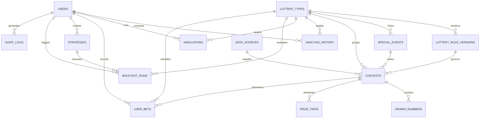

# 02. Diagrama e Modelagem do Banco de Dados (PostgreSQL)

O banco de dados do **LOTUS AI** é executado em **Cloud SQL (PostgreSQL)** e gerenciado via **Drizzle ORM** (`src/db/schema.ts`).

## Diagrama Entidade-Relacionamento (ER)

## Dicionário das 14 Entidades

| Tabela | Chave Primária | Chaves Estrangeiras | Índices Principais | Propósito |
| :--- | :--- | :--- | :--- | :--- |
| `users` | `id` (serial) | — | `uid` (unique), `email` (unique), `role`, `status` | Usuários autenticados, hash scrypt opcional e RBAC |
| `lottery_types` | `id` (serial) | — | `code` (unique), `status` | Modalidades principais configuráveis |
| `lottery_rule_versions` | `id` (serial) | `lottery_type_id` | `(lottery_type_id, version_number)` unique, `(lottery_type_id, valid_from, valid_to)` | Histórico imutável de regras matemáticas |
| `special_events` | `id` (serial) | `lottery_type_id` | `(lottery_type_id, event_type, year)` unique | Concursos especiais vinculados (Virada, Independência, São João) |
| `data_sources` | `id` (serial) | — | `name` (unique) | Fontes oficiais e status de validação |
| `contests` | `id` (serial) | `lottery_type_id`, `rule_version_id`, `special_event_id`, `result_source_id` | `(lottery_type_id, contest_number)` unique, `(lottery_type_id, draw_date)` | Concursos oficiais verificados |
| `drawn_numbers` | `id` (serial) | `contest_id` | `contest_id`, `number_value` | Dezenas sorteadas, ordem e atributos extras |
| `prize_tiers` | `id` (serial) | `contest_id` | `contest_id` | Faixas de premiação, ganhadores e valor em centavos |
| `analysis_history` | `id` (serial) | `user_id`, `lottery_type_id` | `(user_id, executed_at)`, `lottery_type_id` | Auditoria de análises estatísticas executadas |
| `simulations` | `id` (serial) | `user_id`, `lottery_type_id` | `(user_id, created_at)`, `status` | Simulações Monte Carlo com `random_seed` |
| `strategies` | `id` (serial) | `created_by_user_id` | — | Definições versionadas de estratégias matemáticas |
| `backtest_runs` | `id` (serial) | `strategy_id`, `lottery_type_id`, `user_id` | `(strategy_id, lottery_type_id)` | Resultados históricos de backtesting |
| `user_bets` | `id` (serial) | `user_id`, `lottery_type_id`, `contest_id` | `(user_id, recorded_at)` | Combinações registradas pelo usuário |
| `audit_logs` | `id` (serial) | `actor_user_id` | `created_at`, `(target_entity, operation)` | Log administrativo e trilha de auditoria |
